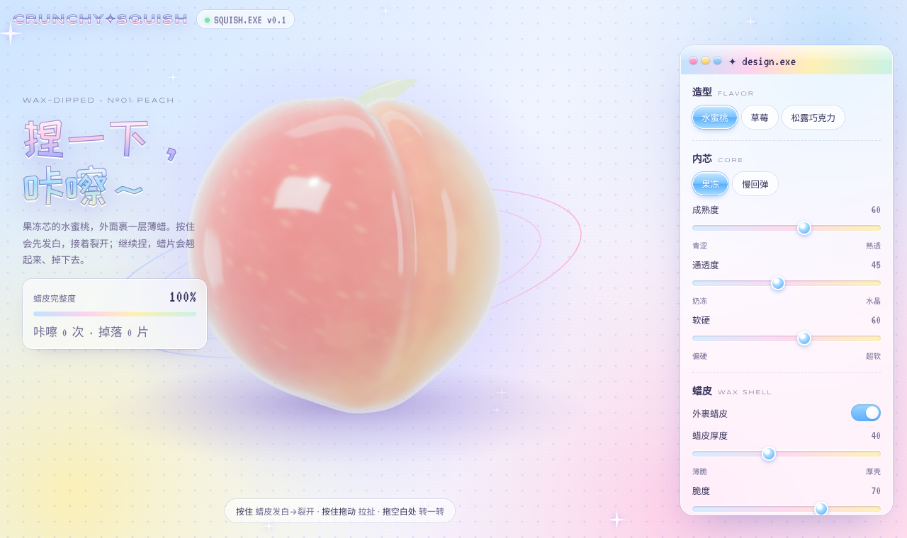
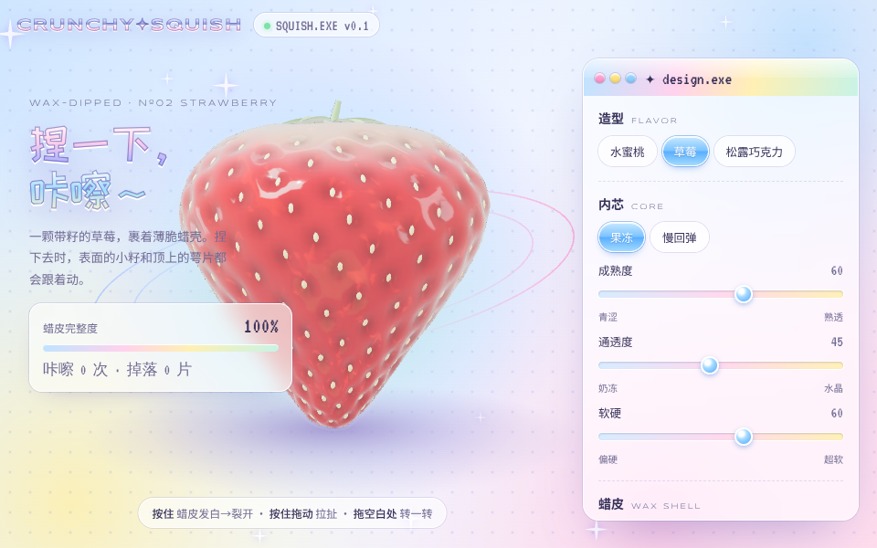
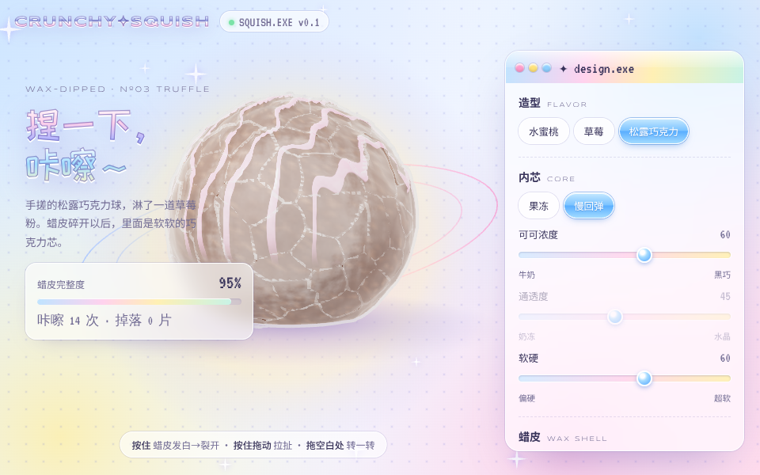
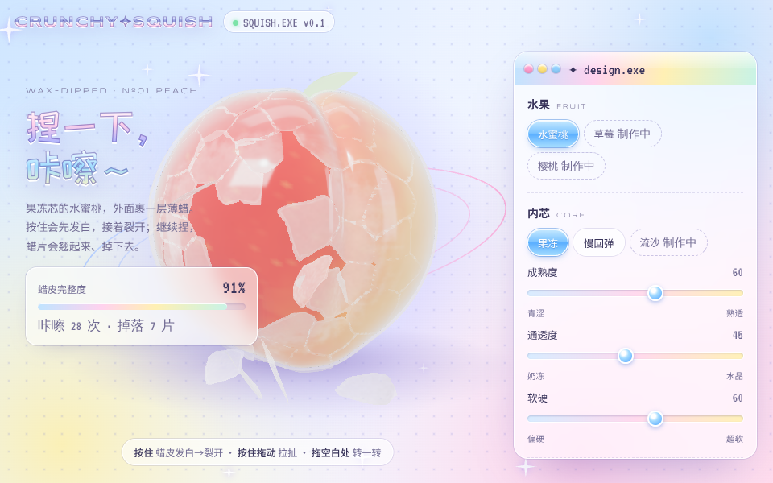

# 脆皮捏捏工坊 · CRUNCHY✦SQUISH

捏一下，咔嚓～

一个在浏览器里玩的 3D 脆皮捏捏。水果外面裹着一层蜡：按下去先发白，接着咔嚓裂开，继续捏蜡片会翘起来、掉到桌上，露出里面软软的内芯。



| 草莓 | 松露巧克力 | 蜡皮碎裂 |
| --- | --- | --- |
|  |  |  |

## 玩法

- **按住**：蜡皮发白，然后裂开
- **按住拖动**：拉扯、拉长
- **拖动空白处**：转着看
- **重新裹蜡**：每次都会生成一套新的裂纹
- **摇一摇**：让捏捏弹一下
- **拍照**：保存一张带咔嚓次数的照片

## 可以设计的部分

- 造型：水蜜桃、草莓、松露巧克力
- 内芯：果冻（有韧性、能拉长）、慢回弹（慢慢鼓回来）
- 成熟度 / 可可浓度、通透度、软硬
- 蜡皮：厚度、脆度、颜色，也可以不裹蜡

## 装到手机桌面

这是一个网页 App（PWA），打开过一次后，没有网络也能玩。

- **iPhone（Safari）**：点底部的分享按钮 →「添加到主屏幕」
- **安卓（Chrome 等）**：点右上角菜单 →「添加到主屏幕」或「安装应用」
- **电脑（Chrome / Edge）**：地址栏右侧的安装图标

## 技术说明

- 纯静态网页，没有后端，也不需要构建步骤
- 3D 渲染用 [three.js](https://threejs.org/)（r149，已放在 `vendor/`，不依赖外部 CDN）
- 字体自托管在 `fonts/`，只保留了用到的字，国内也能正常加载
- 咔嚓声是用 Web Audio 实时合成的，每次都不一样
- `sw.js` 负责离线缓存；发布新版本时把里面的 `VERSION` 改一下

## 本地运行

需要用一个本地服务器打开（直接双击 `index.html` 也能玩，但离线功能不会生效）：

```bash
python3 -m http.server 8000
# 然后打开 http://localhost:8000
```

## 部署到 GitHub Pages

仓库设置 → Pages → Source 选 `Deploy from a branch`，Branch 选 `main` 和 `/ (root)`，保存后等一两分钟就能在 `https://<用户名>.github.io/<仓库名>/` 打开。

## 文件结构

```
index.html            页面和全部逻辑
fonts.css, fonts/     自托管字体
vendor/three.min.js   3D 引擎
manifest.webmanifest  App 名称、图标
sw.js                 离线缓存
icons/                App 图标和预览图
docs/                 README 用的截图
```

## 许可

代码使用 MIT 许可。字体（站酷快乐体、Syncopate、VT323）使用 SIL Open Font License，three.js 使用 MIT 许可。
